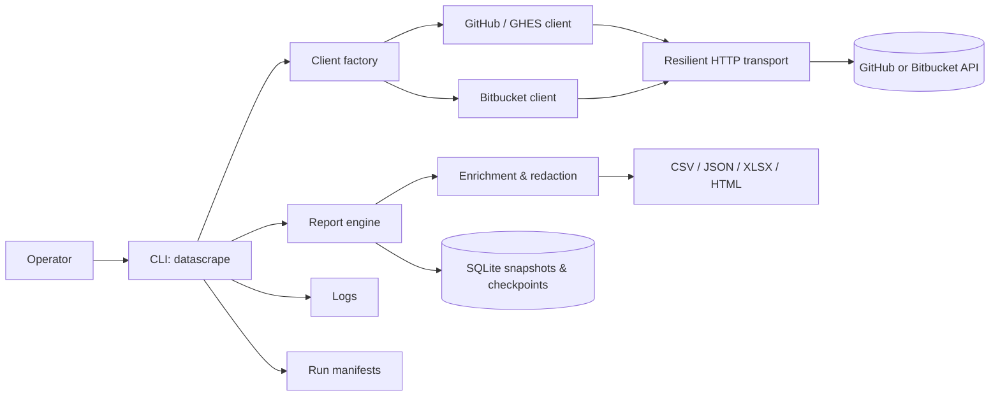
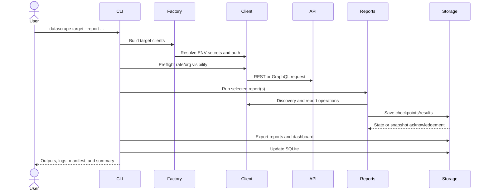
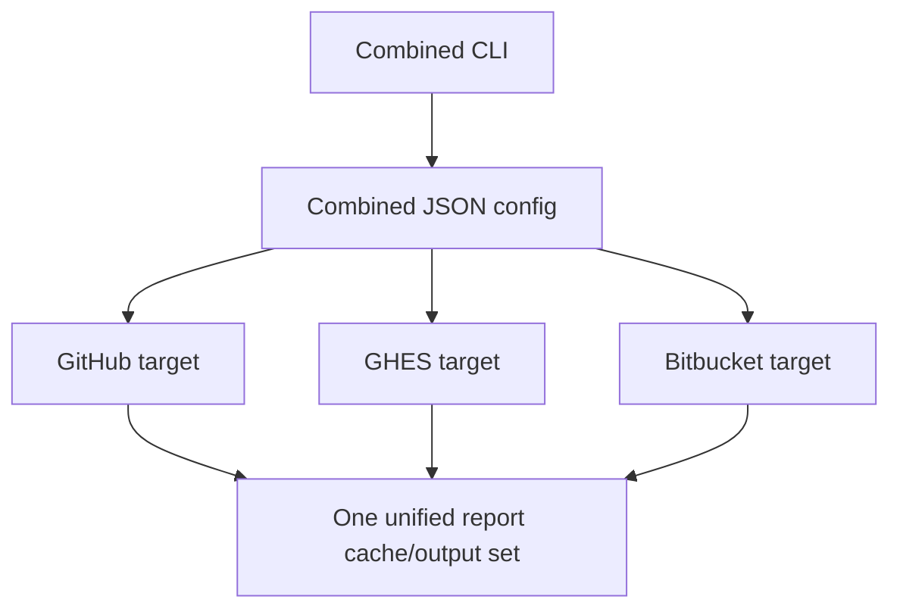
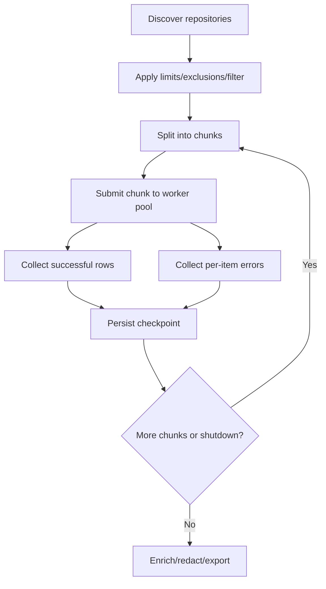
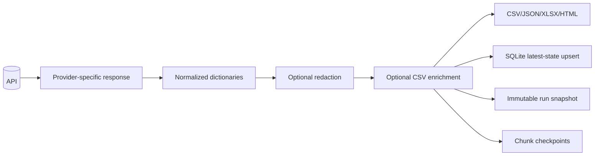

# Architecture

## System overview

## Main components

| Component | Responsibility |
|---|---|
| `datascrape/cli.py` | Argument parsing, configuration, client selection, run lifecycle, output orchestration |
| `datascrape/clients/` | Platform-neutral interface plus GitHub/GHES and Bitbucket implementations |
| `datascrape/http_client.py` | Thread-local sessions, retries, rate-limit coordination, HTTP metrics |
| `datascrape/auth.py` | GitHub App JWT creation and installation-token refresh |
| `datascrape/reports.py` | Report catalog, repository batching, parallel execution, checkpoints, and errors |
| `datascrape/storage.py` | CSV/JSON/XLSX/HTML exports, enrichment, redaction, SQLite, backup and diff/trends |
| `datascrape/run_metadata.py` | Safe JSON run-manifest creation |
| `datascrape/logging_utils.py` | Console/file logging and secret redaction |
| `datascrape/shutdown.py` | Cooperative SIGINT/SIGTERM shutdown |
| `datascrape/progress.py` | Live terminal progress and structured batch logging |

## Execution flow

## Client abstraction

`VCSClient` defines a common interface for repository discovery and report operations. GitHub and GHES share the GitHub implementation; Bitbucket Cloud and Server/Data Center share the Bitbucket implementation. Platform-specific methods translate into normalized result dictionaries.

## Combined-run topology

For `--all-orgs`, a seed client discovers organizations/workspaces/projects and a client scope is created for each selected scope. Enterprise-only scans can run without repository discovery.

## Concurrency model

- Repository discovery occurs before report execution.
- Each report processes repository items in bounded chunks.
- `--workers` or `--threads` controls the thread pool.
- `--batch` or `--chunk-size` controls items submitted per checkpoint batch.
- Completed repositories are isolated: one failure does not abort the entire report.
- Future results are collected at batch boundaries.
- SIGINT/SIGTERM requests a cooperative stop at a batch boundary.

## HTTP resilience

The HTTP transport uses thread-local `requests.Session` objects and a shared rate-limit coordinator keyed by API host and credential identity.

- Retries transient network errors and HTTP 408, 425, 429, 500, 502, 503, and 504 responses.
- Honors `Retry-After` and reset timestamps.
- Applies full-jitter exponential backoff.
- Pauses all workers sharing a coordinator during primary or secondary quota conditions.
- Records request, retry, pause, remaining quota, reset, and resource metrics in the run manifest.

## Data lifecycle

## Operational boundaries

- Datascrape is read-oriented; it does not modify repositories or policies.
- Raw and GraphQL reports can add custom API coverage but remain subject to API permissions.
- Reports are best-effort: unsupported operations become `NOT_SUPPORTED` or empty data instead of necessarily failing.
- Individual item failures are exported as error CSV/JSON and can be retried with `--retry-errors`.
