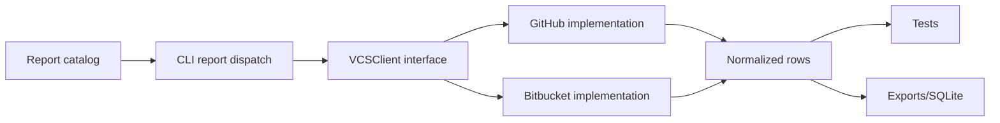

# Development

## Local setup

```bash
python -m venv .venv

# Windows PowerShell
.venv\Scripts\Activate.ps1

python -m pip install -e ".[dev]"
pre-commit install
```

For macOS/Linux:

```bash
source .venv/bin/activate
python -m pip install -e ".[dev]"
pre-commit install
```

## Make targets

```bash
make install
make test
make lint
make format
make pre-commit
make docker-build
make docker-list
make clean
```

## Validation

Run the same checks as the contribution workflow:

```bash
pytest -q
ruff check .
ruff format --check .
bandit -r datascrape
pip-audit
pre-commit run --all-files
```

## Test layout

| Test module | Coverage area |
|---|---|
| `test_client_factory.py` | Target/auth factory behavior |
| `test_github_app_auth.py` | GitHub App JWT/token lifecycle |
| `test_github_client.py` | GitHub API and report behavior |
| `test_http_client.py` | Retry, backoff, rate limits, threads |
| `test_reports_and_cli.py` | Reports, CLI, filtering, raw/GraphQL, diffs |
| `test_storage_and_logging.py` | Exports, SQLite, redaction, logs |

## Testing guidance

- Mock external HTTP and API calls.
- Cover success, permission denial, retry, and interrupted-run behavior.
- Test normalized return dictionaries across GitHub and Bitbucket.
- Use dedicated opt-in credentials for live integration tests.
- Avoid committing real organization data or scan artifacts.

## Adding a report

1. Add the report to `REPORT_CATALOG` in `datascrape/reports.py`.
2. Add platform interface methods to `VCSClient` if needed.
3. Implement the report in `GitHubClient`, `BitbucketClient`, or both.
4. Add report dispatch logic in `run_report`.
5. Define stable record keys and normalized fields.
6. Add tests for success and permission denied behavior.
7. Add the report to [Report Catalog](reports.md).



## Adding a platform capability

- Use the abstract interface as the minimum common contract.
- Preserve normalized field names across platforms where practical.
- Use provider-specific status values only when explicit.
- Implement thread-safe HTTP calls and rate-limit behavior.
- Document authentication and permissions.
- Keep live credentials mocked or opt-in.

## Code style

- Python 3.10 syntax compatibility
- 120-character Ruff line length
- Standard library logging
- Type hints for public interfaces
- Small, testable report and HTTP helpers
- Graceful per-item failures in repository reports

## Security checks

Run before opening a pull request:

```bash
bandit -r datascrape
pip-audit
```

Do not commit:

- `.env` or real credential values
- PEM/private-key files
- Logs or run manifests containing customer metadata
- Generated reports
- SQLite databases and backups
- `targets.json` containing real tokens

The repository owner must select an appropriate license before redistribution.
