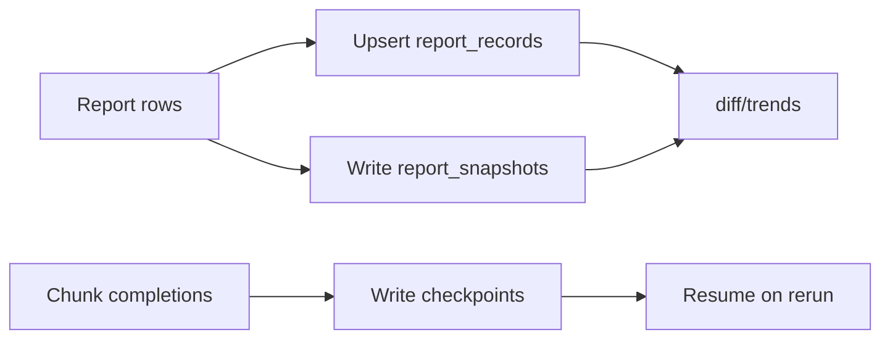

# Outputs and Data Storage

## Report exports

Exports are written to `--out-dir`, defaulting to `./reports`.

### Main report

- `<target>_<report>.csv`
- `<target>_<report>.json`
- `<target>_<report>.xlsx`
- `<target>_<report>.html`

Only the formats selected with `--output` are written.

### Summary rollups

When a report defines a summary, Datascrape writes:

- `<target>_<report>_summary.csv`
- `.json`, `.xlsx`, and/or `.html`

### Error exports

When repository items fail:

- `<target>_<report>_errors.csv`
- `<target>_<report>_errors.json`

The CSV includes an `item` column so `--retry-errors` can select only failed items.

### Executive dashboard

Each successful non-dry run creates:

- `datascrape_dashboard_<run_id>.html`

The dashboard summarizes report row/error counts and links to generated exports.

## Operational artifacts

| Location | Content |
|---|---|
| `./logs/datascrape_*.log` | Timestamped console-equivalent run log |
| `./runs/datascrape_*.json` | Run manifest |
| `./reports/` | Report exports and dashboard |
| `./backups/` | Timestamped SQLite backups |
| `./assessment.db` or custom path | Latest rows, snapshots, checkpoints |

## Run manifest

Each run writes a JSON manifest containing:

- Application version
- Run ID and status
- Start/finish timestamps
- Safe arguments
- Selected reports
- Output paths
- Report row/error counts
- HTTP metrics
- Log file path
- Error text, if failed

Token, private-key, and query/vars values are redacted or omitted from the manifest.

## SQLite schema

Use `--db-path` to enable persistent state.

### `report_records`

Latest state upserted by `(report_type, record_key)`.

### `report_snapshots`

Immutable snapshot rows keyed by `(run_id, report_type, record_key)` for diff operations.

### `checkpoints`

Per-batch progress used by `--resume`.

SQLite uses WAL journaling and a busy timeout for concurrent-safe updates.

## SQLite lifecycle



## Backup

```bash
datascrape github --all-orgs --report all \
  --db-path ./assessment.db --db-backup \
  --db-backup-dir ./backups
```

Backups are named `datascrape_<run_id>.db`.

## History cleanup

```bash
datascrape github --all-orgs --report repo_audit \
  --db-path ./assessment.db --db-retention-days 90
```

This prunes historical snapshots and checkpoints older than the configured number of days.

## Redaction

`--redact-sensitive` removes common credential-bearing fields and patterns, including:

- Access and refresh tokens
- Passwords and secret values
- Private keys
- Authorization fields
- Webhook URLs
- GitHub-style tokens
- Bearer authorization strings
- URL credential/query parameters

Redaction is applied to exported rows, rollups, errors, and saved checkpoints where that option is enabled.

## Data handling recommendations

- Treat exports as confidential by default.
- Store reports outside source control.
- Restrict access to logs and manifests, which may include organization metadata.
- Use `--classification` consistently for governance inventory.
- Set retention flags for recurring automated scans.
- Never commit PEM files, `.env`, SQLite databases, reports, logs, or backups.
- Prefer `ENV:` credential references and a read-only mount for private keys.
